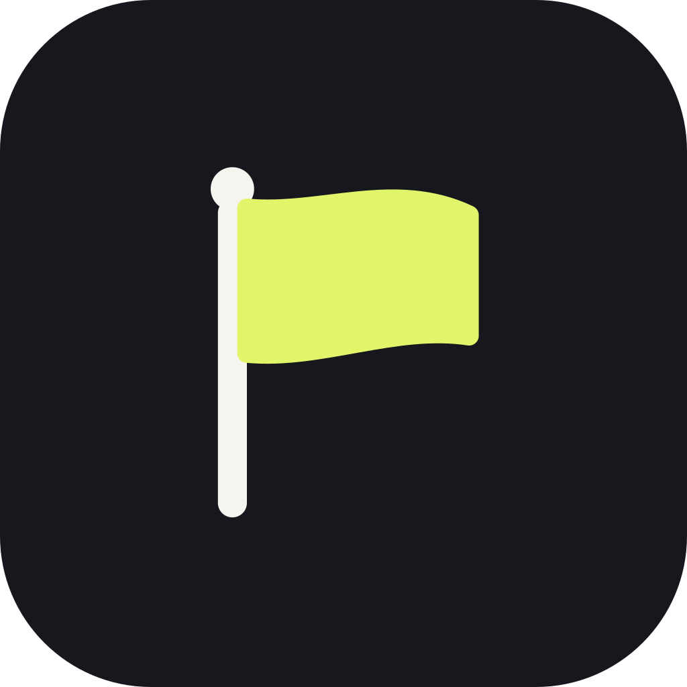
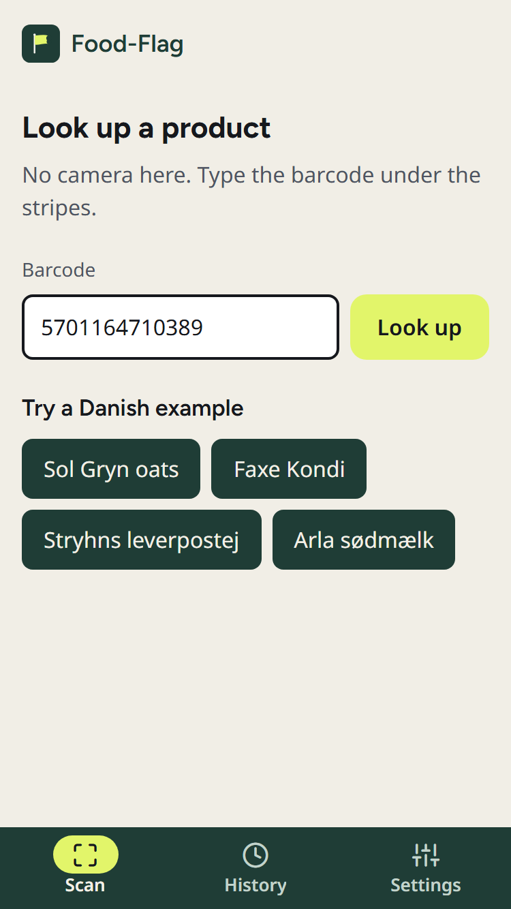
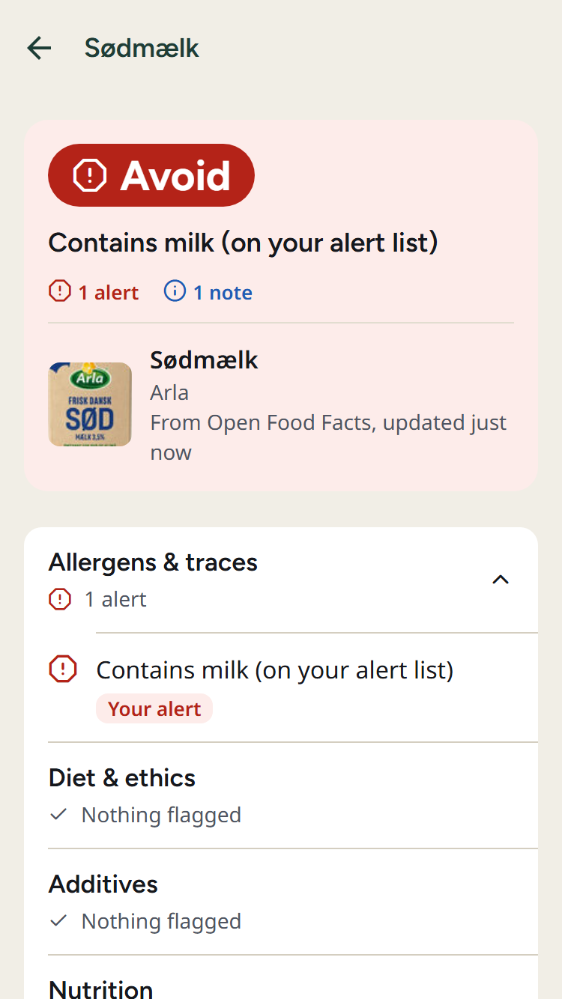
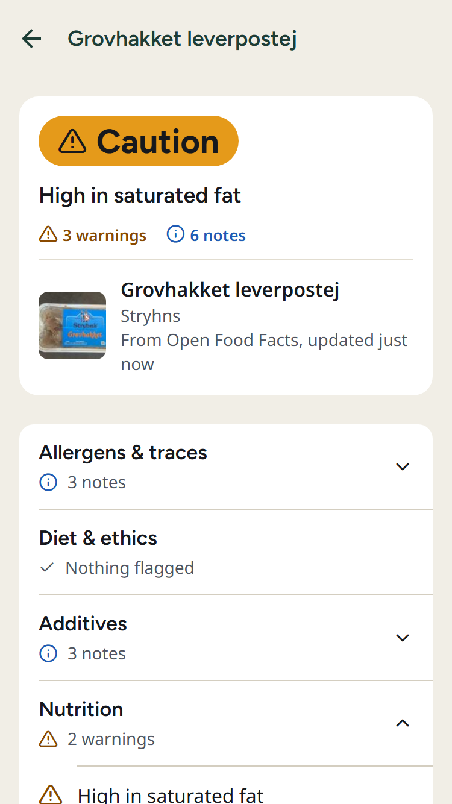
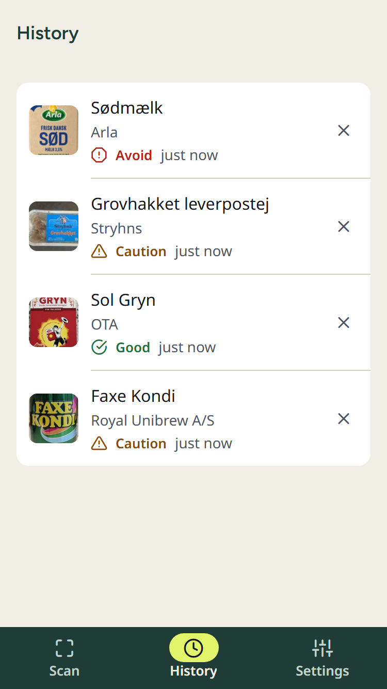
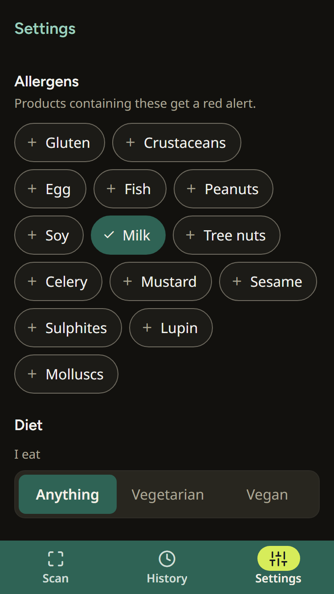

<p align="center">
  
</p>

<h1 align="center">Food-Flag</h1>

<p align="center">
  A grocery scanner for Danish shoppers. Point it at a barcode and get one plain verdict,<br />
  then the reasons: allergens, additives, nutrition, processing and diet.
</p>

<p align="center">
  <a href="https://portfoliokjaer.vercel.app/">Portfolio</a> ·
  Expo SDK 58 · React Native 0.88 · TypeScript · iOS, Android and web
</p>

<table align="center">
  <tr>
    <td></td>
    <td></td>
    <td></td>
    <td></td>
    <td></td>
  </tr>
</table>

<p align="center"><sub>Screenshots from the web build at iPhone SE size (375×667). On iPhone the app uses the system tab bar, navigation bar and SF Symbols.</sub></p>

## Why

Food labels in Denmark are dense, Danish, and printed small. Most scanner apps answer with a score out of 100 or a wall of red. I wanted the opposite for my own shopping: one word you can read at arm's length in the aisle, red only when something conflicts with *you*, and every claim backed by a source you can open.

## What it does

- **Scan or type a barcode.** EAN-13, EAN-8 and UPC-A with the camera (torch included), or by hand with check-digit validation. Store-weighed price labels are recognised and sent to the label reader instead.
- **One verdict first.** Avoid, Caution, OK, Good or Unknown, each with its own colour, icon *and* word, then a one-line headline and counts.
- **Five sections behind it.** Allergens & traces, Diet & ethics, Additives, Nutrition and Processing, each expandable down to the individual flag, with a source link where one applies.
- **Your alerts, not everyone's.** Red is reserved for personal conflicts: the 14 EU allergens you pick, your diet (vegetarian or vegan), palm oil, ultra-processed food (NOVA 3+ or 4) and any E-numbers you add.
- **Reads Danish properly.** Allergen matching knows the false friends: *mælkesyre* (lactic acid) is not milk, *kokosmælk* is not dairy, *kakaosmør* is not butter, *boghvede* (buckwheat) is not wheat.
- **Products missing from Open Food Facts?** Photograph the ingredient list and Claude reads it with your own Anthropic API key, returning the same structured result. Without a key you see a clearly marked example.
- **Works offline.** Every product you scan is cached in History (up to 200), shown instantly next time and refreshed in the background.
- **Appearance.** Follows the system, or force light or dark. iOS Increase Contrast and Reduce Motion are respected.

## How the verdict is decided

A pure rules engine (`src/engine/`) turns a product and your preferences into flags. Each rule is a function `(product, prefs) => Flag[]`, so rules are tested in isolation and composed in `analyze.ts`.

| Rule | Looks at | Based on |
|---|---|---|
| Allergens | OFF allergen tags plus the ingredient text (Danish and English words, false friends excluded) | EU Regulation 1169/2011, Annex II |
| Additives | 106 curated E-numbers with Danish and English names | EU Regulation 1333/2008, EFSA opinions |
| Nutrition | Sugar, saturated fat and salt per 100 g, and sugar as a main ingredient | UK FSA front-of-pack criteria, Nutri-Score |
| Processing | NOVA group | Open Food Facts |
| Diet & ethics | Vegan and vegetarian status, palm oil, Eco-Score | Open Food Facts |

**Severity is deliberate.** An additive is only marked high concern where EU or Danish law, or EFSA, restricts it, bans it or requires a warning; other classifications appear as neutral notes. *Avoid* only ever comes from a conflict with your own settings, and a known allergen conflict outranks missing data, so an allergy is never hidden behind *Unknown*.

## Design

Built through a staged process: brainstorm, interaction spec (flows, edge cases, every component state), a written design system ([DESIGN.md](DESIGN.md)), then motion and a native-platform audit. The specs live in [docs/superpowers/specs](docs/superpowers/specs).

- **Pine and lemon, 60-30-10.** A cream canvas for 60%, deep pine for 30% (titles, selected controls, the toast, the brand tile) and lemon for the 10% that should pop: the one call to action per screen, the brand flag and the scan reticle. Severity colours sit outside the palette, so a verdict never blends into the brand, and severity is never colour alone.
- **Native where it counts.** On iOS: the system tab bar (Liquid Glass on iOS 26, minimises on scroll), native navigation bars with large titles, the system back button with swipe and long-press history, SF Symbols weighted to the text beside them, and inset grouped lists.
- **Accessible by default.** Every text pair is contrast-checked (body text 7:1 or more), Increase Contrast swaps in stronger tokens, Dynamic Type wraps rather than clips, every control is labelled for VoiceOver and TalkBack, and touch targets are at least 44 pt.
- **Motion with a job.** The scan reticle snaps onto the code, the verdict pops in with a haptic that matches it (error, warning or success), chips and tabs answer the tap. Everything uses named duration and spring tokens and switches off with Reduce Motion.
- **Calm feedback.** Successful saves are quiet; failures say what happened and offer Retry. Deleting from History has Undo instead of a confirmation.

## Tech

| | |
|---|---|
| App | Expo SDK 58, Expo Router (native tabs and native stacks), React 19.3, React Native 0.88, TypeScript |
| Camera and media | `expo-camera` barcode scanning, `expo-image-picker`, `expo-image-manipulator` |
| Motion and gestures | Reanimated 4, Gesture Handler 3 (swipe to delete), `expo-haptics` |
| Icons and graphics | `expo-symbols` (SF Symbols on iOS, Material Symbols on Android, Feather on web), `react-native-svg` for the animated brand mark |
| Data | [Open Food Facts](https://world.openfoodfacts.org) API v3 with a v2 fallback, 10 s timeout per attempt |
| AI | Anthropic SDK with structured output validated by Zod (`claude-opus-5-5`) |
| Storage | AsyncStorage for history and preferences; the API key in the iOS Keychain or Android Keystore via `expo-secure-store` (browser storage on web) |
| Tests | Jest (`jest-expo`) for the engine and services, Playwright for end-to-end flows at iPhone SE and desktop sizes |

```
src/
  app/          screens and layouts (Expo Router): (tabs)/(scan|history|settings), product/[barcode], label
  components/   shared UI: ResultView, FlagSection, SummaryCard, Icon, BrandMark, header, controls
  engine/       the rules engine: parse, rules/*, data/additives + allergens, analyze
  services/     Open Food Facts client, label reading, storage, retry
  theme/        tokens (light, dark, high contrast), brand geometry, appearance
e2e/            Playwright flows
scripts/        brand-assets.mjs renders the icon, splash and favicon from the brand geometry
```

## Run it

You need Node 22.13 or newer (Expo SDK 58's minimum). On a phone, install [Expo Go](https://expo.dev/go).

```bash
npm install
npx expo start          # scan the QR code with Expo Go, or press w for the web build
```

```bash
npm test                # 118 unit tests: engine, parsing, OFF client, storage, label reading
npm run typecheck
npx playwright test     # end-to-end at 375×667 and 1280×800 (set E2E_PORT if 8082 is taken)
node scripts/brand-assets.mjs   # regenerate the app icon, splash and favicon
```

To read labels for real, paste an Anthropic API key into **Settings > AI label reading** ([get one here](https://console.anthropic.com/settings/keys)). The key stays on your device; requests go straight from the app to Anthropic.

## Data and credits

- Product data and images: [Open Food Facts](https://world.openfoodfacts.org), under the [Open Database License](https://opendatacommons.org/licenses/odbl/1-0/). The app identifies itself to the API as its terms ask.
- Fonts: [Figtree](https://fonts.google.com/specimen/Figtree) and [Noto Sans](https://fonts.google.com/noto/specimen/Noto+Sans), SIL Open Font License.
- Icons: SF Symbols (Apple), Material Symbols (Google), Feather.

Food-Flag is a personal and portfolio project. It summarises public data and is not medical or dietary advice; always check the label if you have an allergy.
